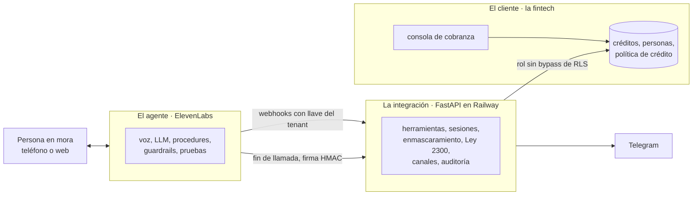
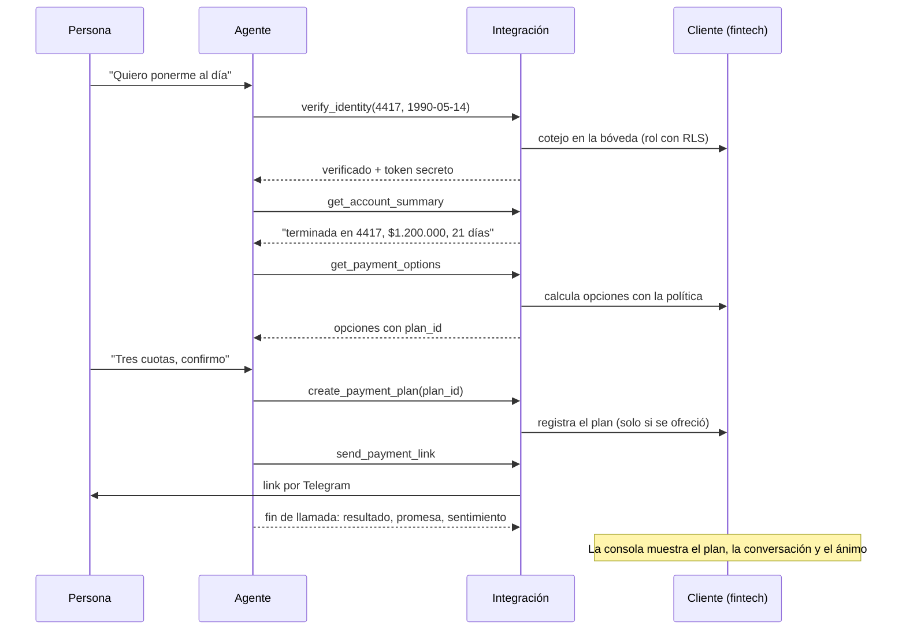

# Agente de cobranza responsable · Avanza Crédito y Nexo Finanzas

Un agente de voz en ElevenLabs que atiende a clientes en mora temprana de una fintech colombiana: verifica su identidad, le ofrece **solo** los planes que permite la política de crédito, registra el acuerdo y le manda el link de pago por Telegram, dentro de la Ley 2300 ("Dejen de fregar").

> El modelo conversa; el código decide todo lo que tiene consecuencias: identidad, dinero y cumplimiento.

| | |
| --- | --- |
| Hablar con el agente (Avanza) | https://elevenlabs.io/app/talk-to?agent_id=agent_1101m4rhgsg7ezv9abbe1ztkgnf6 |
| Consola de la fintech | https://dashboard-production-ea78.up.railway.app |
| Backend (integración) | https://voice-agent-production-64b9.up.railway.app/health |
| Conversation ID de ejemplo | `conv_0701m4rpy0bpf5p8169kkpce77qk` |

Este documento explica **cómo está dividido el sistema y por qué**. Para instalar, desplegar y operar, ver [`cobranza/README.md`](cobranza/README.md). Para el proceso, los errores y el guion del video, ver [`cobranza/docs/guion_video.md`](cobranza/docs/guion_video.md).

---

## Tres piezas: el cliente, la integración y el agente

En un despliegue real con una fintech, cada pieza tiene un dueño distinto. El repo construye las tres, pero las mantiene separadas como si ya existieran por su cuenta.



**Una aclaración de vocabulario.** "Cliente" aquí es **la fintech**: el cliente de ElevenLabs, quien paga. A la persona que debe se le llama "titular" o "persona en mora", aunque en la consola aparezca como "cliente" porque así le dice la fintech.

### 1. El cliente: los sistemas de la fintech

**Qué es.** Lo que Avanza Crédito ya tiene antes de que llegue cualquier agente: su core de créditos, su base de personas, su política de crédito y su equipo de cobranza.

**En un despliegue real:** ya existe. No se reconstruye; se consume a través de sus APIs.

**En este repo:** se simula, con datos ficticios, para que haya algo real contra qué integrar.

| Pieza | Dónde | Qué simula |
| --- | --- | --- |
| Créditos y personas | Supabase, tablas `accounts` y `pii_vault` | El core bancario. La cédula completa y la fecha de nacimiento viven en una bóveda separada |
| Política de crédito | Tabla `tenant_policies` y `backend/app/fintech_sim/policy.py` | Cuántas cuotas, cuota mínima, plazo del primer pago y plan por dificultad. **Es la fintech la que calcula las opciones**, no el agente |
| Calendario | `backend/app/fintech_sim/holidays.py` | Festivos de Colombia (ley Emiliani) |
| Consola de cobranza | `cobranza/dashboard/` y `backend/app/fintech_sim/console.py` | El back office: clientes, planes acordados por voz, cada conversación paso a paso, casos para el equipo y el botón para crear clientes ficticios al azar |
| Pasarela de pago | `GET/POST /pay/{token}` | El checkout donde la persona paga el link |

Hay **dos fintechs** (Avanza Crédito y Nexo Finanzas) con políticas distintas para demostrar que el diseño es multi-cliente de verdad.

### 2. La integración: el trabajo del FDE

**Qué es.** La capa que traduce entre una conversación y los sistemas del cliente. Expone a la conversación contratos pequeños y seguros, y decide todo lo que tiene consecuencias.

**En un despliegue real:** se construye. Es el trabajo de quien despliega (FDE o DS) sobre las APIs de la fintech.

**En este repo:** `cobranza/backend/app/integration/`, un FastAPI en Railway.

| Responsabilidad | Cómo |
| --- | --- |
| Saber qué fintech llama | Cada agente manda `X-Tenant-Key`, una llave que vive como secreto del workspace de ElevenLabs. El backend solo guarda su hash |
| Verificar identidad | `verify_identity` coteja los últimos 4 de la cédula y la fecha de nacimiento, y devuelve un token de sesión. Tres intentos fallidos bloquean la conversación |
| No dejar que el modelo vea lo que no debe | El token viaja en una variable dinámica secreta que el LLM nunca lee. Las cuentas salen enmascaradas ("terminada en 4417") y los montos en texto para voz |
| Que el dinero salga de la política | `create_payment_plan` solo acepta un `plan_id` que se le ofreció a esa misma sesión. Es idempotente: confirmar dos veces no crea dos planes |
| Cumplir la Ley 2300 | `GET /compliance/contact-window` dice si una llamada **saliente** está permitida ahora: horario legal, domingos y festivos, un contacto al día, un canal por semana, opt-out y disputas |
| Enviar el link | Un adaptador de canal: Telegram hoy; WhatsApp ya está escrito y espera la plantilla aprobada por Meta |
| Dejar evidencia | Cada llamada a una herramienta, aceptada o rechazada, queda en `audit_log`. El webhook de fin de llamada guarda el resultado, la promesa y el sentimiento |

**Las 8 herramientas que ve el agente:** `verify_identity`, `get_account_summary`, `get_payment_options`, `create_payment_plan`, `send_payment_link`, `register_dispute`, `register_opt_out` y `request_callback`. Son las únicas puertas hacia el cliente.

**El aislamiento entre fintechs no depende del código.** El backend se conecta a Postgres con `cobranza_app`, un rol sin `BYPASSRLS`. Cada transacción fija `app.tenant_id` y la seguridad por fila filtra todo. Aunque un query tuviera un bug, Postgres no devolvería filas de otra fintech.

### 3. El agente: el producto

**Qué es.** La conversación: voz, modelo, procedimientos, guardrails, base de conocimiento y pruebas, en ElevenLabs Agents.

**En un despliegue real:** se construye. Es lo que la fintech compra.

**En este repo:** el agente es código. Una plantilla y un archivo por fintech generan los dos agentes (Sofía para Avanza, Horacio para Nexo).

| Pieza | Dónde |
| --- | --- |
| Configuración completa con huecos `${...}` | `cobranza/agent_configs/_template.json` |
| Lo que cambia por fintech: nombre, voz, canal, llave | `cobranza/agent_configs/avanza.json`, `nexo.json` |
| System prompt | `cobranza/prompts/system_prompt.md` |
| Una herramienta por archivo | `cobranza/tool_configs/` |
| Procedimientos: estructurados donde un error cuesta, libres donde hay que escuchar | `cobranza/procedure_configs/` |
| FAQ, Ley 2300 y aviso de datos | `cobranza/knowledge_base/` |
| 11 pruebas por agente | `cobranza/test_configs/` |
| Construir, validar contra el OpenAPI de ElevenLabs y publicar | `cobranza/scripts/agents.py` |

**Lo que el agente decide:** cómo hablar, a qué procedimiento entrar, cuándo escalar y cuándo colgar.

**Lo que no decide:** quién es la persona, cuánto debe, qué plan existe o si se puede llamar ahora. Para eso llama a la integración, y si se equivoca, la integración lo rechaza.

---

## Quién decide qué

| Decisión | Agente | Integración | Cliente |
| --- | :---: | :---: | :---: |
| Cómo saludar, escuchar y explicar | ✔ | | |
| Cambiar a inglés sin repetir la verificación | ✔ | | |
| Si la persona es el titular | | ✔ | |
| Qué datos de la cuenta se pueden decir | | ✔ | |
| Qué planes existen y por cuánto | | | ✔ |
| Si un plan elegido es válido | | ✔ | |
| Si una llamada saliente cumple la Ley 2300 | | ✔ | |
| Por dónde sale el link de pago | | ✔ | ✔ (elige el canal) |
| Quién revisa disputas, asesorías y opt-outs | | | ✔ |

---

## Una llamada, de punta a punta



---

## Qué cambia en un despliegue real

| Hoy en el repo | Con una fintech real |
| --- | --- |
| Supabase con datos ficticios hace de core bancario | Las APIs de la fintech; la integración cambia de "consulta SQL" a "llamada HTTP" sin tocar al agente |
| La consola lee directo de la base con un rol de solo lectura | Su CRM o su herramienta de cobranza, alimentados por el webhook de fin de llamada |
| La persona llama desde la web | Telefonía real (SIP o Twilio) y campañas salientes que consultan primero `contact-window` |
| Telegram | WhatsApp con plantilla de utilidad aprobada por Meta, cambiando un valor por fintech |
| Aislamiento por fila en una base compartida | Según el banco: un esquema, una base o cómputo dedicado por fintech |

---

## Mapa del repo

```
specs                      el spec original del take-home
cobranza/
  README.md                instalación, despliegue y operación
  docs/guion_video.md      proceso, errores resueltos y guion del video
  agent_configs/  prompts/  tool_configs/  procedure_configs/  knowledge_base/  test_configs/
  scripts/agents.py        build / push / test / chat del agente          ← el agente
  backend/app/integration/ herramientas, auth, sesiones, Ley 2300, canales ← la integración
  backend/app/fintech_sim/ política, festivos, consola                    ← el cliente (simulado)
  supabase/migrations/     esquema, RLS, roles y datos semilla            ← el cliente (simulado)
  dashboard/               consola de cobranza en React                   ← el cliente (simulado)
```
