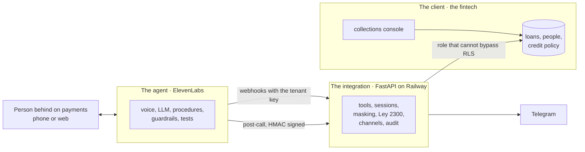
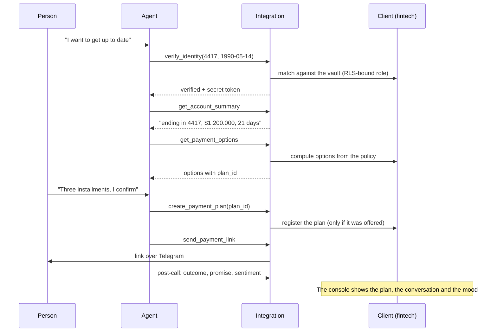

# Responsible collections agent · Avanza Crédito and Nexo Finanzas

An ElevenLabs voice agent that handles early-stage collections for a Colombian fintech. It verifies the caller's identity, offers **only** the plans the credit policy allows, registers the agreement and sends the payment link over Telegram, within Ley 2300 ("Dejen de fregar", Colombia's collections-harassment law).

> The model talks; the code decides anything with consequences: identity, money and compliance.

| | |
| --- | --- |
| Talk to the agent (Avanza) | https://elevenlabs.io/app/talk-to?agent_id=agent_1101m4rhgsg7ezv9abbe1ztkgnf6 |
| Fintech console | https://dashboard-production-ea78.up.railway.app |
| Backend (integration) | https://voice-agent-production-64b9.up.railway.app/health |
| Example Conversation ID | `conv_0701m4rpy0bpf5p8169kkpce77qk` |

This document explains **how the system is split and why**. For setup, deployment and operations, see [`cobranza/README.md`](cobranza/README.md). The agent speaks Colombian Spanish and switches to English if the customer does. The console has a Spanish/English switch in its header.

---

## Three pieces: the client, the integration and the agent

In a real deployment with a fintech, each piece has a different owner. This repo builds all three, but keeps them apart as if they already existed on their own.



**A note on vocabulary.** "Client" here means **the fintech**: ElevenLabs' customer, the one who pays. The person who owes money is the "account holder", even though the console calls them "clientes", because that's what the fintech calls them.

### 1. The client: the fintech's own systems

**What it is.** What Avanza Crédito already has before any agent shows up: its core lending system, its customer records, its credit policy and its collections team.

**In a real deployment:** it already exists. It isn't rebuilt; it's consumed through its APIs.

**In this repo:** it's simulated with fictitious data, so there is something real to integrate against.

| Piece | Where | What it stands in for |
| --- | --- | --- |
| Loans and people | Supabase, tables `accounts` and `pii_vault` | The core banking system. Full national IDs and birth dates live in a separate vault |
| Credit policy | Table `tenant_policies` and `backend/app/fintech_sim/policy.py` | Number of installments, minimum installment, first-payment deadline and the hardship plan. **The fintech computes the options**, not the agent |
| Calendar | `backend/app/fintech_sim/holidays.py` | Colombian public holidays (including the ones moved to Monday by the Ley Emiliani) |
| Collections console | `cobranza/dashboard/` and `backend/app/fintech_sim/console.py` | The back office: customers, plans agreed by voice, every conversation step by step, cases for the team, and a button that creates random fictitious customers |
| Payment gateway | `GET/POST /pay/{token}` | The checkout page where the person pays the link |

There are **two fintechs** (Avanza Crédito and Nexo Finanzas) with different policies, to show the design is truly multi-tenant.

### 2. The integration: the deployment engineer's job

**What it is.** The layer that translates between a conversation and the client's systems. It gives the conversation small, safe contracts, and it decides anything with consequences.

**In a real deployment:** it gets built. It's the work of whoever deploys the agent (an FDE or a Deployment Strategist), on top of the fintech's APIs.

**In this repo:** `cobranza/backend/app/integration/`, a FastAPI service on Railway.

| Responsibility | How |
| --- | --- |
| Knowing which fintech is calling | Each agent sends `X-Tenant-Key`, a key stored as an ElevenLabs workspace secret. The backend only stores its hash |
| Verifying identity | `verify_identity` matches the last 4 digits of the national ID and the birth date, and returns a session token. Three failed attempts lock the conversation |
| Keeping things away from the model | The token travels in a secret dynamic variable the LLM never reads. Accounts come back masked ("terminada en 4417") and amounts as text ready to be spoken |
| Making money come from the policy | `create_payment_plan` only accepts a `plan_id` that was offered to that same session. It's idempotent: confirming twice doesn't create two plans |
| Complying with Ley 2300 | `GET /compliance/contact-window` says whether an **outbound** contact is allowed right now: legal hours, Sundays and holidays, one contact per day, one channel per week, opt-outs and open disputes |
| Sending the link | A channel adapter: Telegram today. WhatsApp is already written and waits for a Meta-approved template |
| Leaving evidence | Every tool call, accepted or rejected, is written to `audit_log`. The post-call webhook stores the outcome, the promise to pay and the sentiment |

**The 8 tools the agent sees:** `verify_identity`, `get_account_summary`, `get_payment_options`, `create_payment_plan`, `send_payment_link`, `register_dispute`, `register_opt_out` and `request_callback`. They are the only doors into the client's systems.

**Isolation between fintechs doesn't rely on the code being right.** The backend connects to Postgres as `cobranza_app`, a role without `BYPASSRLS`. Each transaction sets `app.tenant_id`, and row-level security filters everything. Even a buggy query could not return another fintech's rows.

### 3. The agent: the product

**What it is.** The conversation: voice, model, procedures, guardrails, knowledge base and tests, on ElevenLabs Agents.

**In a real deployment:** it gets built. It's what the fintech is buying.

**In this repo:** the agent is code. One template plus one file per fintech generate both agents (Sofía for Avanza, Horacio for Nexo).

| Piece | Where |
| --- | --- |
| Full configuration with `${...}` placeholders | `cobranza/agent_configs/_template.json` |
| What changes per fintech: name, voice, channel, key | `cobranza/agent_configs/avanza.json`, `nexo.json` |
| System prompt | `cobranza/prompts/system_prompt.md` |
| One tool per file | `cobranza/tool_configs/` |
| Procedures: structured where a mistake costs money or privacy, free-form where the agent has to listen | `cobranza/procedure_configs/` |
| FAQ, Ley 2300 and the data-processing notice | `cobranza/knowledge_base/` |
| 11 tests per agent | `cobranza/test_configs/` |
| Build, validate against the ElevenLabs OpenAPI, and publish | `cobranza/scripts/agents.py` |

**What the agent decides:** how to speak, which procedure to enter, when to escalate and when to hang up.

**What it doesn't decide:** who the person is, how much they owe, which plans exist, or whether it may call right now. For that it calls the integration, and if it gets something wrong, the integration rejects it.

---

## Who decides what

| Decision | Agent | Integration | Client |
| --- | :---: | :---: | :---: |
| How to greet, listen and explain | ✔ | | |
| Switching to English without verifying again | ✔ | | |
| Whether the person is the account holder | | ✔ | |
| Which account details may be said aloud | | ✔ | |
| Which plans exist and for how much | | | ✔ |
| Whether the chosen plan is valid | | ✔ | |
| Whether an outbound contact complies with Ley 2300 | | ✔ | |
| Which channel the payment link goes through | | ✔ | ✔ (picks the channel) |
| Who handles disputes, callbacks and opt-outs | | | ✔ |

---

## One call, end to end



---

## What changes in a real deployment

| In this repo | With a real fintech |
| --- | --- |
| Supabase with fictitious data plays the core banking system | The fintech's APIs. The integration goes from "SQL query" to "HTTP call" without touching the agent |
| The console reads straight from the database with a read-only role | Their CRM or collections tool, fed by the post-call webhook |
| The person calls from the web | Real telephony (SIP or Twilio), and outbound campaigns that check `contact-window` first |
| Telegram | WhatsApp with a Meta-approved utility template, by changing one value per fintech |
| Row-level isolation in a shared database | Depending on the bank: a schema, a database, or dedicated compute per fintech |

---

## Repo map

```
specs                      the original take-home spec
cobranza/
  README.md                setup, deployment and operations
  agent_configs/  prompts/  tool_configs/  procedure_configs/  knowledge_base/  test_configs/
  scripts/agents.py        build / push / test / chat for the agent       ← the agent
  backend/app/integration/ tools, auth, sessions, Ley 2300, channels      ← the integration
  backend/app/fintech_sim/ policy, holidays, console                      ← the client (simulated)
  supabase/migrations/     schema, RLS, roles and seed data               ← the client (simulated)
  dashboard/               collections console in React                   ← the client (simulated)
```
