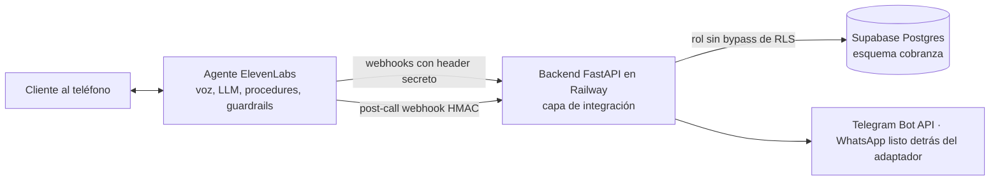

# Agente de cobranza responsable: qué se construyó, cómo y por qué

Documento de trabajo para preparar el video del take-home (Deployment Strategist, Colombia). Tiene tres usos:

1. **Entender todo el sistema**, pieza por pieza, con la justificación de cada decisión.
2. **Contar el proceso**, incluidos los errores que aparecieron y cómo se resolvieron. Esto es lo que más le sirve a un cliente: muestra criterio, no solo resultado.
3. **Grabar el video**, con un guion técnico y didáctico al final (sección 9).

---

## 1. La idea en una frase

Un agente de voz en ElevenLabs que llama o atiende a clientes en mora temprana de una fintech colombiana, verifica su identidad, le ofrece **solo** los planes que permite la política de crédito, registra el acuerdo y le manda el link de pago por Telegram, todo dentro de la Ley 2300 ("Dejen de fregar").

**El principio que guía todo el diseño:**

> El modelo conversa; el código decide todo lo que tiene consecuencias: identidad, dinero y cumplimiento.
> *(The model talks; the code decides anything with consequences: identity, money and compliance.)*

---

## 2. El problema y por qué alguien pagaría por esto

| Pregunta | Respuesta |
| --- | --- |
| ¿Quién paga? | La gerencia de cobranza de la fintech. |
| ¿Qué reemplaza o complementa? | Un call center de gestores humanos marcando y contestando todo el día. |
| ¿Por qué ahora? | La Ley 2300 de 2023 limita la cobranza: lunes a viernes de 7 a.m. a 7 p.m., sábados de 8 a.m. a 3 p.m., un contacto al día y un solo canal por semana. **Hay menos contactos permitidos, así que cada contacto tiene que valer más.** |
| ¿Qué métrica le importa al dueño? | Promesas de pago cumplidas por cada 100 contactos. El agente deja cada promesa registrada (data collection y tabla `call_outcomes`). |

**Enfoque:** cobranza humana, no agresiva. Cumplir la ley, ofrecer planes realistas y escalar a una persona cuando hay dificultad económica. Eso es más ético y además es mejor historia comercial.

**Avanza Crédito** y **Nexo Finanzas** son ficticias. Existen dos para demostrar que el diseño es multi-cliente de verdad.

---

## 3. Arquitectura: tres capas

| Capa | Qué es | En el take-home | En un despliegue real |
| --- | --- | --- | --- |
| El agente | Voz, modelo, procedures, guardrails, pruebas | Se construye | Se construye: **es el producto** |
| Capa de integración | Herramientas con contratos limpios, token de sesión, enmascaramiento, cumplimiento, canal | FastAPI | Se construye: **es el trabajo del FDE/DS** sobre las APIs del cliente |
| Sistemas de la fintech | Créditos, clientes, política, mensajería | Simulados en Supabase con datos ficticios | Ya existen; no se reconstruyen |

**Didáctico:** el backend hace de "doble" del core bancario de la fintech. En producción no reescribiría su sistema de créditos; construiría esta capa de integración encima de sus APIs.

El [`README.md`](../../README.md) de la raíz del repo explica estas tres piezas (el cliente, la integración y el agente) con una tabla de quién decide qué y el recorrido de una llamada. Sirve como apoyo visual para el bloque técnico del video.

---

## 4. Lo que se construyó, pieza por pieza

### 4.1 Base de datos (Supabase / Postgres)

**Proyecto:** `avanza-cobranza` (`thebjscyzczyghbuqtvz`, us-east-1). Ocho migraciones en `supabase/migrations/`: esquema, semilla, agentes por tenant, `search_path` fijo, rol de la consola, sentimiento, Telegram por defecto y clientes ficticios.

**Tablas** (todas en el esquema privado `cobranza`, todas con `tenant_id`):

| Tabla | Para qué |
| --- | --- |
| `tenants`, `tenant_agents` | Las fintechs (con el **hash** de su llave) y qué agente de ElevenLabs pertenece a cuál |
| `tenant_policies` | La política de crédito de cada fintech |
| `pii_vault` | La bóveda de datos personales: cédula, fecha de nacimiento, teléfono, chat de Telegram |
| `accounts` | Los créditos: últimos 4 dígitos, monto vencido, saldo total, días de mora, estado |
| `sessions` | Sesiones verificadas (solo el hash del token) |
| `payment_offers` | Las opciones que se le ofrecieron a una sesión concreta |
| `payment_plans`, `payment_links` | Acuerdos registrados y links de pago |
| `contacts`, `disputes`, `callbacks`, `call_outcomes` | Historial de contacto (Ley 2300), disputas, devoluciones de llamada y resultados de cada llamada |
| `audit_log` | La bitácora: cada llamada a una herramienta, aceptada o rechazada, con tenant y `conversation_id` |

**Cómo funciona el aislamiento entre fintechs (seguridad por fila, RLS):**

1. Cada tabla tiene una política: "solo ves filas donde `tenant_id = cobranza.current_tenant()`".
2. En cada transacción, el backend ejecuta `set_config('app.tenant_id', 'avanza', true)`, el equivalente a `SET LOCAL`, y eso es lo que lee `current_tenant()`.
3. El backend se conecta con el rol `cobranza_app`, que **no** tiene `BYPASSRLS` ni es superusuario.

**Por qué el rol importa:** en Supabase, el rol `service_role` se salta la seguridad por fila. Si el backend se conectara con él, el aislamiento sería decorativo. Con `cobranza_app`, aunque un query del backend tuviera un bug, Postgres no le devolvería filas de otra fintech.

**Por qué un esquema privado (`cobranza`) y no `public`:** la API automática de Supabase (PostgREST) solo publica `public`. Así, nadie puede consultar estas tablas desde internet con la llave pública de Supabase; solo el backend.

**Funciones `SECURITY DEFINER`:** hay operaciones que necesitan ver algo antes de saber el tenant. Por ejemplo, resolver la llave a una fintech, o cotejar la identidad contra la bóveda. Para eso hay funciones pequeñas con permisos elevados y un `search_path` fijo, para que no se puedan secuestrar. Exponen solo el dato mínimo; por ejemplo, `match_identity` devuelve la cuenta y el primer nombre, nunca la cédula.

**Datos semilla:**

| Fintech | Política |
| --- | --- |
| Avanza Crédito | Hasta 3 cuotas, cuota mínima $150.000, primer pago en máximo 5 días; plan de dificultad de 6 cuotas con 30 días de gracia |
| Nexo Finanzas | Hasta 2 cuotas, cuota mínima $200.000, primer pago en 3 días; sin plan de dificultad |

Clientes de prueba: **Laura** (Avanza, cédula terminada en 4417, nacida el 14/05/1990, $1.200.000 vencidos, 21 días de mora), Carlos, Marta, y **Andrés** en Nexo, con **la misma identidad que Laura**. Eso es a propósito: prueba que la misma cédula en dos fintechs no cruza datos.

**Clientes al azar:** el botón "Agregar cliente al azar" de la consola crea más clientes ficticios, con nombre, cédula, nacimiento, producto, mora, días y saldo aleatorios.
- **Por qué no rompe el modelo de seguridad:** la consola sigue siendo de solo lectura. El backend llama, como `cobranza_app` y dentro de un solo tenant, a la función `create_demo_customer`, que solo puede **agregar** una persona y una cuenta a esa fintech. No modifica ni borra nada.
- **Reglas de la función:** hay un tope de 40 cuentas por fintech. Los últimos 4 de la cédula más la fecha de nacimiento no se repiten dentro de la fintech, porque son la llave de la verificación. El cliente nuevo hereda el chat de Telegram de la demo.

### 4.2 Backend (FastAPI, en Railway)

Separado como pide el spec:

- `app/integration/`: lo que construye un FDE (herramientas, autenticación, sesiones, enmascaramiento, cumplimiento, canales, webhooks).
- `app/fintech_sim/`: lo que la fintech ya tendría (política de crédito, cálculo de planes, festivos de Colombia).

**Las 8 herramientas** que llama el agente:

| Herramienta | Qué hace | Detalle que importa |
| --- | --- | --- |
| `verify_identity` | Coteja últimos 4 de cédula y fecha de nacimiento | Devuelve un token de sesión. Bloquea tras 3 intentos fallidos por conversación |
| `get_account_summary` | Estado de la cuenta | Solo enmascarado: "terminada en 4417", montos en texto para voz ("$1.200.000") |
| `get_payment_options` | Hasta 3 planes | **Los calcula el código** desde la política; cada uno con `plan_id` |
| `create_payment_plan` | Registra el acuerdo | Solo acepta un `plan_id` que se ofreció **a esa misma sesión**. Idempotente |
| `send_payment_link` | Envía el link por el canal de la fintech | Telegram hoy; WhatsApp ya implementado detrás del mismo adaptador |
| `register_dispute` | Abre una disputa | Pausa la cobranza de esa cuenta |
| `register_opt_out` | "No me vuelvan a llamar" | Funciona **sin** verificación; si el cliente se verificó en la misma llamada, se vincula a su cuenta |
| `request_callback` | Agenda la llamada de un asesor | También funciona sin verificación |

**Endpoints internos** (no son herramientas):

- `POST /webhooks/post-call`: ElevenLabs avisa al final de cada llamada con los datos recolectados. Se verifica la firma HMAC.
- `GET /compliance/contact-window`: antes de una llamada saliente, ¿la ley lo permite ahora? Acepta `at` para evaluar cualquier fecha (por ejemplo, un domingo).
- `GET` y `POST /pay/{token}`: página de pago simulada, en HTML semántico.
- `GET /console/...` y `POST /console/{tenant}/customers`: la consola de la fintech (lectura, y crear un cliente ficticio).

**La Ley 2300 aplica a lo que la empresa inicia.** Llamadas y mensajes salientes de cobranza. Si el cliente llama o abre la consola a las 11 p.m. o un domingo, nada se bloquea, y así debe ser. El link de Telegram tampoco pasa por la ventana: se envía dentro de una llamada que el cliente inició y porque lo aceptó. `contact-window` es la puerta que usaría una campaña saliente; el sistema todavía no hace llamadas salientes.

**Las reglas que viven en código y no en el prompt (y por qué):**

| Regla | Cómo se aplica | Por qué no basta el prompt |
| --- | --- | --- |
| Identidad antes de revelar | Toda herramienta de cuenta exige un token de sesión válido | Un LLM puede ser convencido; una consulta SQL sin token no devuelve nada |
| Token fuera del modelo | El token viaja en la variable dinámica secreta `secret__session_token`, asignada desde la respuesta de la herramienta con `sanitize` | Si el LLM no lo ve, no lo puede filtrar ni inventar |
| Solo planes de la política | `create_payment_plan` rechaza un `plan_id` que no salió de `get_payment_options` en esa sesión (`422 plan_not_offered`) | Aunque el modelo "acepte" un descuento, el backend no lo registra |
| Idempotencia | La llave de idempotencia es el `conversation_id`; si el cliente confirma dos veces, no se crean dos planes | En voz es común repetir "sí, sí, confirmo" |
| Validación estricta | Pydantic con patrones exactos (4 dígitos, fechas, formato de `plan_id`) | El LLM puede mandar basura; se rechaza con un error claro |
| Auditoría | Cada llamada, aceptada o rechazada, queda en `audit_log`. Los rechazos se guardan en una transacción aparte para que no se pierdan | Es la evidencia para el cliente y para el regulador |
| Ley 2300 | Función pura `evaluate_contact_window`: horario legal, domingos y festivos (ley Emiliani), un contacto al día, un canal por semana, opt-out y disputas bloquean | Es una regla de negocio determinística; no puede depender de un modelo |

**Autenticación de cada fintech:** cada agente manda `X-Tenant-Key`, una llave guardada como secreto del workspace de ElevenLabs. El backend la convierte en hash SHA-256 y la busca; la base nunca ve la llave original. También manda `X-Tenant-Id`; si no coincide con la llave, se rechaza y queda en la bitácora.

**Adaptador de canal:** `send_payment_link` no sabe si el mensaje sale por WhatsApp o Telegram. Cada fintech tiene un campo `channel`, y cambiar de canal es cambiar ese valor. Las dos usan Telegram (es el valor por defecto de la tabla `tenants`): WhatsApp exige una plantilla de utilidad aprobada por Meta porque la empresa escribe primero, y eso no cabía en el plazo. En producción corre con `CHANNEL_MODE=live` y el link llega de verdad a Telegram. Con `CHANNEL_MODE=log`, el link se imprime en los logs en vez de enviarse; así corren las pruebas.

### 4.3 El agente como código

El agente no se configuró a mano en el dashboard: está en archivos JSON dentro del repo y un script lo publica. **Por qué:** se puede revisar en git, repetir, revertir, y generar varias fintechs desde una sola plantilla.

| Carpeta | Contenido |
| --- | --- |
| `agent_configs/_template.json` | La configuración completa del agente con huecos (`${...}`) |
| `agent_configs/avanza.json`, `nexo.json` | Lo que cambia por fintech: nombre del agente (Sofía, Horacio), voz, canal, primer mensaje, llave |
| `prompts/system_prompt.md` | El system prompt (unos 900 tokens; la guía recomienda menos de 2.000) |
| `tool_configs/` | Una herramienta por archivo |
| `procedure_configs/` | Los 8 procedures |
| `knowledge_base/` | FAQ, Ley 2300 y aviso de tratamiento de datos |
| `test_configs/` | Las 11 pruebas y los mocks |
| `scripts/agents.py` | `build`, `push`, `test`, `chat`, `voices` y `status` |

**`build` (gratis, sin conexión):** arma los payloads finales y los valida contra el esquema OpenAPI oficial de ElevenLabs, más reglas que el esquema no expresa: reglas de los procedures, guardrails, variables dinámicas que no existirían en una llamada real y tamaño del prompt. **Por qué existe:** cada error atrapado aquí es una publicación fallida (o créditos) que no se gasta.

**`push`:** crea o actualiza, en orden, el webhook de fin de llamada, el secreto, las herramientas, la base de conocimiento, las pruebas, el agente, los procedures (en orden de dependencias) y publica. Guarda los IDs en `deploy_state.json` para no duplicar. **Por qué un script y no `elevenlabs agents push`:** la CLI oficial no cubre procedures, secretos del workspace ni un juego de herramientas por fintech.

**Configuración del agente:**

| Ajuste | Valor | Por qué |
| --- | --- | --- |
| Modelo | `claude-haiku-4-5` | Tras la primera llamada real se bajó de `claude-sonnet-5` a Haiku por latencia y costo; las reglas duras viven en procedimientos, backend y guardrails, no en el modelo. Se cambia con `ELEVENLABS_LLM` |
| Voz | `eleven_v4_turbo`, modo expresivo, velocidad 1.0 | Más natural. Se probó 0.95 para montos y fechas, pero en voz se sentía lento; la claridad la dan las frases cortas, un monto por frase |
| Idioma | Español, con preset en inglés y detección de idioma | Clientes que prefieren inglés |
| Primer mensaje | Divulgación de IA y grabación | Requisito de ElevenLabs antes de interactuar |
| `trust_context` | `low` | El usuario es externo y no confiable |
| Retención | 90 días | Política de privacidad explícita |
| Duración máxima | 6 minutos | Corta llamadas que se alargan sin avanzar |

**Procedures: estructurados donde un error cuesta, libres donde hay que escuchar.**

| Procedure | Tipo | Por qué ese tipo |
| --- | --- | --- |
| Verificación de identidad | Estructurado | Saltarse un paso cuesta privacidad. La bifurcación final usa una **expresión** sobre `identity_verified`, no el criterio del LLM |
| Acuerdo de pago | Estructurado | Es una transacción: resumen → opciones → elegir → repetir y confirmar → registrar → enviar link |
| Escalamiento a asesor | Estructurado | Siempre termina en un callback registrado |
| Escalamiento por falla técnica | Estructurado | Con parámetros fijados por `schema_overrides`, que el modelo no ve |
| Dificultad económica | Libre | Hay que escuchar a una persona angustiada |
| Disputa de la deuda | Libre | No discutir, registrar, explicar el siguiente paso |
| No volver a contactar | Libre | Inmediato, sin persuadir |
| Contesta un tercero | Libre | No confirmar ni negar que exista una deuda |

**Reintento y escalamiento ante fallas:** cada paso de herramienta tiene un manejador de falla. Si falla una vez, se dice "tuve un problema, lo intento de nuevo" y se reintenta. Si falla de nuevo, se agenda un asesor. Si eso también falla, el agente se despide sin inventar datos. Esto se genera automáticamente en `build` (sub-procedures `reintento_<herramienta>`; ver el error 7 en la sección 6).

**Guardrails de plataforma (defensa en profundidad: la regla va en el prompt y además como guardrail independiente):**

| Guardrail | Configuración |
| --- | --- |
| Focus | Activado |
| Manipulación (prompt injection) | Activado |
| Custom "Sin amenazas" | Streaming, cuelga. Bloquea mencionar centrales de riesgo, demandas o consecuencias |
| Custom "Sin descuentos inventados" | Streaming, cuelga. Evaluador `claude-haiku-4-5`. Bloquea descuentos y montos o fechas que no vengan de una herramienta |

**Recolección de datos y evaluación:**

- **Data collection:** resultado (`promesa`, `disputa`, `escalado`, `opt_out`, `sin_acuerdo`), monto y fecha prometidos, razón del atraso, dificultad económica e idioma. **Ninguno es un dato personal:** es el resultado de la llamada, no quién es la persona.
- **5 criterios de evaluación:** identidad antes de revelar, sin amenazas, opt-out respetado, siguiente paso concreto, y montos solo de herramientas.

### 4.4 Pruebas

| Nivel | Qué cubre | Resultado |
| --- | --- | --- |
| **Backend (pytest), 29 pruebas** contra el Supabase real | Camino ideal; sesión obligatoria; bloqueo por intentos; validación; plan inventado o ajeno; conflicto de idempotencia; aislamiento entre fintechs; RLS directo en Postgres; disputa; opt-out (vinculado, no vinculado y de otra fintech); callback; ventana Ley 2300; firma del webhook; política y festivos | 29/29 |
| **Batería del agente en ElevenLabs, 11 pruebas × 2 agentes** | Camino ideal; pedir la cuenta sin verificar; identidad falla; contesta un tercero; descuento del 90%; inyección de prompt; perdió el trabajo; disputa; "no me llamen"; backend caído; cambio a inglés | Última corrida completa: 21/22. Tras el último ajuste del guardrail, 10/10 en las pruebas que lo tocan |
| **Conversación real** (`agents.py chat`, texto por WebSocket, sin mocks) | Que las herramientas lleguen de verdad a Railway y a Supabase, que el link llegue a Telegram y que llegue el webhook de fin de llamada | Destapó 2 bugs reales (errores 18 y 19); arreglados. Repetida con Telegram en vivo: 5 herramientas, el link llegó al celular (`conv_9201m4ry0cszeqhr10fnmzhe7yxw`) |
| **Prueba directa del canal** (herramientas llamadas como lo haría el agente, sin ElevenLabs) | Que el token del bot y el chat de Telegram funcionen sin gastar créditos | Destapó 2 errores de configuración (26 y 27); arreglados |

---

## 5. El proceso, en orden

1. **Leer el spec y la documentación de ElevenLabs.** Del OpenAPI embebido en la CLI salieron los nombres exactos de campos y las reglas de procedures, guardrails y pruebas.
2. **Base de datos primero:** esquema, RLS, rol sin bypass y semilla de dos fintechs.
3. **Backend y sus pruebas** contra la base real. Las reglas que tienen consecuencias se probaron antes de que existiera el agente.
4. **Agente como código:** plantilla, herramientas, procedures, guardrails y pruebas, con validación offline.
5. **Despliegue:** Railway para el backend y `push` a ElevenLabs.
6. **Batería de pruebas del agente:** pasó de 14/22 a 22/22 corrigiendo configuración, no el backend.
7. **Conversación real sin mocks:** encontró lo que ninguna prueba simulada podía ver.
8. **Ajuste final del guardrail de montos** y control de gasto de créditos.
9. **Consola de la fintech:** el back office en React, con la llamada en vivo hecha con ElevenLabs UI, el sentimiento de cada conversación y clientes ficticios al azar.
10. **Telegram en vivo:** primero probado sin créditos, llamando a las herramientas directamente; después, con una conversación real con el agente.

---

## 6. Errores que aparecieron y cómo se resolvieron

Cada error tiene el mismo formato: **síntoma → causa → arreglo → por qué así**. Esta sección es la más valiosa para el cliente: demuestra que el sistema se probó contra la realidad y no solo contra la teoría.

### Base de datos y backend

**1. El pooler de Supabase no reconocía el usuario.**
- **Síntoma:** "tenant/user not found" al conectar.
- **Causa:** el host del pooler era `aws-1-...`; el proyecto vive en `aws-0-us-east-1`.
- **Arreglo:** usar el host correcto, con el puerto 6543 (transaction pooler) y `statement_cache_size=0` en asyncpg.
- **Por qué:** el transaction pooler escala mejor con muchas conexiones cortas, pero no soporta sentencias preparadas cacheadas.

**2. El advisor de seguridad de Supabase marcó `search_path` mutable.**
- **Causa:** la función `current_tenant()` no fijaba su `search_path`.
- **Arreglo:** migración 4, que lo fija.
- **Por qué:** una función con `search_path` abierto puede ser engañada con un objeto del mismo nombre en otro esquema. En una función de seguridad, eso importa.
- El otro aviso ("RLS sin políticas" en `tenants` y `tenant_agents`) es **intencional**: esas tablas niegan todo al rol de la app y solo se leen por funciones definer. Quedó documentado con comentarios en la base.

**3. Una prueba usaba un `plan_id` imposible.**
- **Causa:** los IDs usan un alfabeto sin letras ambiguas (sin U, O, I, L), y la prueba tenía esas letras.
- **Arreglo:** usar un ID válido pero no ofrecido, y esperar `422 plan_not_offered`.
- **Por qué:** así se prueba la regla de negocio (plan no ofrecido) y no la validación de formato.

**4. El mensaje de opt-out decía "Avanza Crédito" también en Nexo.**
- **Causa:** el nombre estaba escrito a mano en el código.
- **Arreglo:** usar el nombre del tenant autenticado.
- **Por qué:** en multi-tenant, cualquier texto fijo es un bug esperando a aparecer.

### Configuración del agente

**5. El OpenAPI oficial tenía referencias rotas.**
- **Síntoma:** el validador fallaba con `DynamicVariablesConfig-Input` inexistente.
- **Arreglo:** normalizar las referencias `-Input`/`-Output` a su versión sin sufijo.
- **Por qué:** sin eso no había validación offline, y cada error se descubriría publicando.

**6. La expresión "OR" de la verificación estaba mal formada.**
- **Causa:** el nodo `or_operator` usa una lista `children`, no `left`/`right`.
- **Arreglo:** corregido; lo detectó la validación offline, antes de publicar.

**7. El paso nativo "Retry" cuelga la llamada cuando se agotan los intentos.**
- **Problema:** el spec pide "reintentar una vez y luego ofrecer un asesor", y Retry no puede expresarlo.
- **Arreglo:** el `build` genera sub-procedures `reintento_<herramienta>`: dice una frase puente, reintenta y, si falla, pasa a "escalamiento por falla técnica".
- **Por qué:** colgarle a alguien porque nuestro sistema falló es la peor experiencia posible en cobranza.

**8. El modelo recomendado no existe en la API.**
- **Hallazgo:** la guía menciona Claude Sonnet 5.5, pero el enum de la API solo tiene `claude-sonnet-5`.
- **Arreglo:** usar `claude-sonnet-5`, configurable con `ELEVENLABS_LLM`, y decirlo explícitamente.

### Despliegue

**9. Railway no encontraba la aplicación (Railpack).**
- **Causa:** construía desde la raíz del repo, donde no hay Dockerfile.
- **Arreglo:** Root Directory = `cobranza/backend`.

**10. El contenedor se caía: falta `DATABASE_URL`.**
- **Causa:** Railway no lee el `.env` local, que además está fuera de git a propósito.
- **Arreglo:** cargar las variables en Railway. Aclaración importante para el cliente: `DATABASE_URL` **apunta a Supabase**; Railway solo corre el código.

**11. El backend arrancaba pero respondía 502.**
- **Causa:** Railway asignó el puerto 8080 (`PORT`) y el dominio apuntaba al 8000.
- **Arreglo:** apuntar el dominio al 8080 (con el MCP de Railway).
- **Por qué no fijar 8000:** respetar `$PORT` es lo que espera la plataforma.

**12. `BACKEND_URL` sin `https://`, y variables vacías que pisaban llaves reales.**
- **Causa:** el script leía `backend/.env` y luego `.env`; una línea vacía en el segundo borraba la llave del primero.
- **Arreglo:** ignorar valores vacíos al combinar archivos.

**13. Publicaciones que fallaban "en silencio".**
- **Causa:** al filtrar la salida con un pipe, el error de ElevenLabs no detenía el proceso, y las pruebas corrían contra la configuración anterior.
- **Arreglo:** `pipefail`, y reglas nuevas en `build` para los rechazos que el OpenAPI no expresa (ver error 17).
- **Lección:** confiar en "¿quedó publicado?" solo con evidencia.

### Batería de pruebas: de 14/22 a 22/22

**14. Las pruebas de tercero, disputa y opt-out fallaban en ambos agentes.**
- **Causa:** eran pruebas de **un solo turno**. Con procedures, el primer turno del agente es "entrar al procedure"; la herramienta se llama en el siguiente, y la prueba no lo veía.
- **Arreglo:** convertirlas en **simulaciones multi-turno** con criterios claros.
- **Por qué:** se prueba el comportamiento real de la conversación, no un artefacto del formato de prueba.

**15. "Backend caído": el agente entraba en un ciclo.**
- **Síntoma:** intentaba abrir una y otra vez el procedure de verificación.
- **Causa:** los sub-procedures tenían el disparador vacío; el agente no sabía cuál abrir y abría el que ya estaba activo. Nexo acertaba de casualidad.
- **Arreglo:** disparadores descriptivos ("solo cuando otro procedure te pasa aquí porque `verify_identity` falló una vez; nunca por pedido del cliente").
- **Por qué:** el modelo elige procedures por su descripción; sin descripción, adivina.

**16. Nexo "fallaba" el camino ideal por decir Telegram.**
- **Causa:** el mock del link decía `whatsapp`, pero Nexo usa Telegram. El agente tenía razón y la prueba estaba mal.
- **Arreglo:** mocks con el canal de cada fintech.
- **Lección:** cuando una prueba falla, primero preguntarse si la prueba es correcta.

**17. El guardrail de montos cortaba la conversación cuando el cliente cambiaba a inglés.** Fue el más difícil; vale la pena contarlo completo:

1. **Diagnóstico por bisección:** desactivando guardrails uno a uno, la prueba pasaba sin "Sin descuentos inventados". Era ese.
2. **Hipótesis:** en modo streaming, el guardrail evalúa el texto **mientras se genera**. Un número a medias (`$400,00…`) o en otro formato (`$1,200,000` frente a `$1.200.000`) parecía un monto inventado.
3. **Intento: modo blocking**, que espera la respuesta completa. ElevenLabs lo rechazó para agentes de voz con `evaluate_full_response_only`, porque el audio ya se está diciendo. Sin ese flag, el modo blocking hizo que el agente no respondiera en 60 segundos: en una llamada real, eso es silencio.
4. **Intento: "reintentar" en vez de colgar.** ElevenLabs solo lo permite en modo blocking.
5. **Decisión:** volver a lo que recomienda la documentación para voz (**streaming y colgar**) y atacar la causa:
   - un prompt que tolera formatos, idiomas y números cortados;
   - y un **evaluador más capaz**: `claude-sonnet-4-6` en vez de `gemini-3.5-flash`.
6. **Resultado:** 10/10 en las pruebas que tocan el guardrail (inglés, descuento, camino ideal y dificultad), manteniendo la regla completa del spec.
7. **Ajuste por costo tras la primera llamada real:** la factura mostró que el evaluador Sonnet costaba ~US$0.42 por llamada, 10 veces lo que costaba el agente con Haiku. Con el prompt ya afinado, se cambió a `claude-haiku-4-5` y pasaron las 4 pruebas que tocan el guardrail. La lección: el prompt corregido era lo que importaba; el modelo grande fue un andamio.

**Por qué no simplemente quitar el guardrail:** el riesgo que cubre (prometer un descuento que no existe) es el más caro del caso. Además, el backend ya impide registrar un plan no ofrecido, así que hay dos capas independientes.

### La prueba que más enseñó: una conversación real sin mocks

**18. En una llamada real, ninguna herramienta llegaba al backend.**
- **Síntoma:** Railway no recibía ninguna petición a `/tools/...`; el agente decía "tuve un problema" y escalaba.
- **Causa:** el header `X-Tenant-Id` salía de una variable dinámica que solo existía en las pruebas, porque el script la inyectaba. En una conversación real esa variable no existe y ElevenLabs no envía la petición.
- **Arreglo:**
  - `X-Tenant-Id` pasó a constante en cada herramienta (cada fintech ya tiene su propio juego de herramientas);
  - el script dejó de inyectar `tenant_id` en las pruebas;
  - `build` ahora rechaza headers que dependan de variables no disponibles en llamadas reales.
- **Por qué es mejor:** el tenant queda fijo por configuración; nadie lo puede elegir durante la conversación.

**19. Opt-out y callback exigían el token de sesión, que no existe antes de verificar.**
- **Arreglo:** esas dos herramientas ya no reciben token. Si el cliente se verificó en **la misma conversación**, el backend vincula la solicitud a su cuenta usando el `conversation_id`. Ese dato viene de una variable del sistema que el modelo no controla, y la seguridad por fila lo limita a la fintech que llama.
- **Prueba nueva:** el opt-out se vincula dentro de la misma conversación, no se vincula en otra, y no se vincula si llama otra fintech.

**20. Herramientas de prueba que engañan.**
- La simulación de conversaciones de la API **no llama** a los webhooks reales: responde "Tool Called." y el agente improvisa. Por eso se construyó `agents.py chat`, que abre una conversación real por WebSocket en modo texto.
- En la primera versión de `chat`, el audio y los pings que manda el servidor reiniciaban el temporizador de silencio, y la llamada duró hasta el máximo de 6 minutos generando audio. Se arregló contando solo las respuestas del agente y usando modo `text_only`, que no genera audio.

**21. Gasto de créditos.** Unas 7 corridas completas de 22 simulaciones, unas 30 sueltas y una llamada de voz de 6 minutos. **Lección aplicada:**
- validar todo lo posible offline (gratis);
- correr solo las pruebas afectadas por cada cambio;
- confirmar antes de cada corrida que gasta créditos.

### Lo que enseñó la primera llamada real de voz

**22. El flujo funcionaba, pero el agente hablaba de corrido.**
- **Síntoma:** entre verificar la identidad y presentar las opciones, Sofía habló casi un minuto seguido: tres anuncios ("ya te verifiqué, ahora reviso…", "voy a revisar si hay alivio…") y dos resultados, sin dejar hablar al cliente.
- **Causa:** el backend responde en ~1 segundo, así que el sonido de "tecleo" de las herramientas casi no suena. Además, el procedimiento encadenaba sin pausa estado de cuenta, consulta de opciones y presentación.
- **Arreglo:**
  - el procedimiento ahora **se detiene** después del estado de cuenta y pregunta si el cliente quiere revisar las opciones;
  - máximo dos frases por respuesta, un solo anuncio antes de cada herramienta, un monto o fecha por frase;
  - no decir cuántas opciones existen ("tengo tres opciones" cuando solo se presentan dos confundía);
  - la voz bajó a velocidad 0.95 (después se devolvió a 1.0: en una llamada se sentía lenta, y las frases cortas ya resolvían la claridad).
- **Por qué no meter demoras artificiales en el backend:** alargar la espera no le da al cliente el turno de hablar; el problema era de turnos, no de silencio.

**23. Cambios de configuración desde el dashboard.** Se cambió el modelo a `claude-haiku-4-5`, la voz y el TTS a `eleven_v4_turbo` desde la interfaz de ElevenLabs. Como el agente vive en código, esos cambios se llevaron a la plantilla; si no, el siguiente `push` los habría borrado. De paso apareció que la copia del OpenAPI de la CLI estaba desactualizada (no conocía `eleven_v4_turbo`), y el script pasó a validar contra el OpenAPI vivo de la API.

**24. Una prueba con el mock equivocado.** La prueba de "perdió el trabajo" aceptaba el plan de 6 cuotas, pero el mock de `create_payment_plan` devolvía el de 3 cuotas. El evaluador lo detectó con Haiku; se creó un mock propio para el plan de dificultad.

**25. Lo que trajo el OpenAPI vivo.** Al validar contra el OpenAPI de la API (y no la copia de la CLI) aparecieron campos que la plantilla no usaba. Se activaron los que atacan lo que mostró la llamada real:
- **sonido de fondo de oficina** a volumen bajo (`conversation.background_sound`), para que un silencio corto no suene a llamada caída;
- **frase de espera** generada por el modelo si la respuesta tarda más de 2.5 segundos (`turn.soft_timeout_config`), en el idioma del cliente y sin montos;
- **"ajá", "mjm", "ok" o "claro" ya no interrumpen** a la agente (`turn.interruption_ignore_terms`);
- **un modelo de respaldo**: si Haiku no responde en 5 segundos, pasa a GPT-5.6 Luna y luego a Gemini 3.5 Flash (`backup_llm_config`);
- en el link `talk-to`, el revisor ve **el ID de la conversación y cuándo corre cada herramienta**.

La **redacción de datos personales en el historial** también existe en la API, pero al publicarla respondió `403 feature_not_available: requires an enterprise subscription`. Queda como brecha, ahora con evidencia.

El **análisis de sentimiento** ya venía activo: cada conversación trae una etiqueta, un puntaje de frustración y el punto más bajo. El webhook de fin de llamada lo guarda y la consola lo muestra. La llamada con Laura terminó en +0.6 después de un mínimo de −0.3; la de Nexo terminó con frustración 1.0 y se pasó a un asesor.

### Telegram de verdad: dos errores que ninguna prueba simulada habría visto

Antes de gastar créditos, se probó el canal llamando a las herramientas de producción directamente, como lo haría el agente (verificar, opciones, plan, link), con un `conversation_id` de prueba que la consola oculta. La bitácora (`audit_log`) guarda el error exacto de Telegram, y eso hizo el diagnóstico inmediato.

**26. Telegram respondía `404 Not Found`.**
- **Causa:** el token del bot en Railway no era válido. Un 404 en la API de Telegram significa que no reconoce el token; si el problema fuera el chat, diría "chat not found".
- **Arreglo:** volver a copiar el token de @BotFather. De paso, el backend ahora limpia espacios y comillas del token, que es el error típico al pegarlo.

**27. Telegram respondía `403: the bot can't send messages to the bot`.**
- **Causa:** el ID de chat registrado era el del bot, no el de la persona. Pasa al reenviarle un mensaje del bot a @userinfobot.
- **Arreglo:** escribirle directamente a @userinfobot para obtener el ID propio y actualizarlo en la bóveda. Después de eso, el link llegó.
- **Lección:** el adaptador estaba bien; lo que falla en un canal real es la configuración. Por eso se prueba el canal aparte, sin créditos, antes de la conversación completa.

### Lo que mostró la conversación con Telegram en vivo

**28. Dos detalles de habla.** La conversación completa funcionó (verificó, ofreció, registró el plan y el link llegó), pero:
- dijo "tienes tres opciones", presentó dos y preguntó "¿cuál de estas dos?". El procedimiento ya decía "nunca digas cuántas opciones hay", y aun así lo hizo. La instrucción ahora da el patrón exacto: empezar con "Puedes pagar…", seguir con "O también…" y cerrar con "¿Cuál te funciona mejor?";
- dijo "veintiuno días". El prompt ahora tiene una regla de concordancia: "veintiún días", "un millón de pesos", "una cuota".
- **Lección:** con un modelo rápido como Haiku, una prohibición ("no cuentes") funciona peor que un ejemplo de qué decir en su lugar.
- **Y aun así volvió a contarlas.** La causa de fondo era el contrato: `get_payment_options` devolvía las 3 opciones de Avanza en la misma lista (pago único, cuotas y dificultad), y el modelo cuenta lo que ve. **Arreglo estructural:** el plan de dificultad sale ahora en un campo aparte, `hardship_option`, y `options` solo trae lo que se puede ofrecer a cualquiera. El backend sigue registrando las tres ofertas, así que el `plan_id` de dificultad sigue siendo válido. Resultado: 29/29 en pytest, 11/11 en Avanza, y en la conversación real ya no cuenta las opciones.
- **Lección de fondo:** si el modelo insiste en un error a pesar del prompt, el arreglo está en el contrato de la herramienta: no darle lo que no debe decir.

### La consola

**29. La transcripción de la llamada en vivo pasaba de una fintech a otra.**
- **Síntoma:** después de hablar con Sofía y cambiar a Nexo, el panel seguía mostrando la conversación de Avanza.
- **Causa:** la transcripción vivía en el componente principal, que no cambia al cambiar de fintech, y nada la limpiaba.
- **Arreglo:** al elegir otra fintech (también con atrás y adelante del navegador), el panel cuelga si hay una llamada, limpia la transcripción y descarta cualquier mensaje tardío de la llamada anterior.
- **Por qué importa:** en multi-tenant, mostrar en la pantalla de Nexo lo que dijo un cliente de Avanza es exactamente el tipo de fuga que el resto del diseño evita.

**30. El sonido de "tecleo" estaba configurado, pero no se oía.**
- **Síntoma:** la agente decía "voy a revisar tu crédito" y en menos de medio segundo ya estaba dando el resultado.
- **Causa:** las herramientas corrían en modo `immediate`, en paralelo con la frase puente. El backend responde antes de que termine la frase, y el sonido de tecleo solo suena mientras la herramienta corre, así que no le quedaba tiempo.
- **Intento:** `execution_mode: "post_tool_speech"` en las 8 herramientas, para que la herramienta espere a que termine la frase puente y el tecleo llene el tiempo.
- **Lo que pasó en las llamadas de voz:** empeoró todo.
  - Cada herramienta pasó de menos de 1 segundo a entre 3 y 6. Eso disparó la frase de espera, y cada respuesta empezaba con "Un momento.".
  - En Horacio, el paso de herramienta dentro del procedure de verificación nunca llamó a `verify_identity`. El procedure lo tomó como falla, reintentó y terminó en "falla técnica" con un asesor.
  - En Sofía, con las respuestas encadenadas, dijo "para mañana, sábado diecisiete de octubre". "Mañana" era inventado, y el guardrail de montos y fechas cortó la llamada. El guardrail hizo su trabajo.
- **Arreglo:** volver a `immediate`, que es lo que funcionaba. Además, el prompt principal ahora prohíbe fechas relativas ("hoy", "mañana"), porque el agente no sabe qué día es. La regla de no contar las opciones pasó del procedure al prompt principal, porque solo en el procedure no se cumplía.
- **Lección:** las pruebas evalúan texto, no tiempos, así que no habrían visto este problema. Un cambio de tiempos solo se valida con una llamada de voz, y un ajuste "cosmético" puede romper el flujo.

---

## 7. Estado actual

| Pieza | Estado | Evidencia |
| --- | --- | --- |
| Supabase (esquema, RLS, rol, semilla) | Listo | Consultas directas: 14 tablas, RLS activo, `cobranza_app` sin bypass |
| Backend en Railway | En línea | `/health` 200; `verify-identity` real contra Supabase |
| Webhook de fin de llamada | Funciona | Railway respondió 200 con firma HMAC válida |
| Agentes publicados | Sí | Avanza: `agent_1101m4rhgsg7ezv9abbe1ztkgnf6`; Nexo: `agent_0901m4rhh9q7es19m1h50f729s3p` |
| Pruebas del backend | 29/29 | pytest |
| Batería del agente | **Corrida final: 22/22** (Avanza 11/11, Nexo 11/11), con todos los cambios publicados | Corridas en ElevenLabs |
| Conversación real de voz | Hecha | 4 minutos con Laura: verificó, ofreció el plan de dificultad, lo registró y envió el link |
| Ritmo tras resultados de herramientas | Ajustado (procedure, sonido de fondo, frase de espera), falta oírlo | Una llamada de voz más |
| Conteo de opciones y concordancia ("veintiún días") | Corregido y publicado, falta oírlo | Una llamada de voz más |
| Consola de la fintech | En línea | https://dashboard-production-ea78.up.railway.app: clientes (y clientes al azar), planes con link de pago, conversaciones con sentimiento, llamada en vivo |
| Conversation ID para entregar | `conv_0701m4rpy0bpf5p8169kkpce77qk` | 5/5 criterios, datos completos, terminó con `end_call` |
| Envío real por Telegram | Listo | `CHANNEL_MODE=live`; el link llegó al celular en una conversación real (`conv_9201m4ry0cszeqhr10fnmzhe7yxw`) |
| Redacción de datos personales | Brecha confirmada | La API respondió 403: requiere Enterprise |

**Link para hablar con el agente:** https://elevenlabs.io/app/talk-to?agent_id=agent_1101m4rhgsg7ezv9abbe1ztkgnf6

---

## 8. Decisiones de diseño, en una tabla (para defenderlas)

| Decisión | Alternativa descartada | Por qué |
| --- | --- | --- |
| El backend decide identidad, montos y cumplimiento | Reglas solo en el prompt | Un prompt se puede manipular; una consulta sin token no |
| Token secreto fuera del modelo | Que el LLM pase el token | Lo que el modelo no ve, no lo filtra ni lo inventa |
| Procedures estructurados solo donde un error cuesta | Todo estructurado o un workflow | Lo libre escucha mejor; lo estructurado no se salta pasos |
| Un agente por fintech, una plantilla | Un agente con variables por llamada | Cada agente solo tiene su llave; el aislamiento es por credencial |
| RLS con rol sin bypass | Filtrar por `tenant_id` en el código | Un bug en un query no puede cruzar fintechs |
| Esquema privado en Supabase | Tablas en `public` | No quedan expuestas por la API automática |
| Streaming en guardrails | Blocking | En voz, blocking genera silencios; la documentación lo recomienda así |
| Agente como código y validación offline | Configurar en el dashboard | Revisable, repetible, reversible y más barato de probar |
| Canal detrás de un adaptador | Código distinto por canal | Cambiar WhatsApp por Telegram es cambiar un valor |
| Consola de solo lectura; crear clientes por una función acotada | Darle permisos de escritura a la consola | La única escritura posible es "agregar un cliente ficticio a esta fintech" |

---

## 9. Guion del video (Loom, 5 minutos, una toma)

Formato del spec: **narración en inglés**, agente en español con la transcripción visible. Son notas para hablar, no un texto para leer en voz alta. Debajo de cada bloque va "en español" para que tengas claro qué estás diciendo.

### Antes de grabar

- [ ] Hacer una llamada de voz corta de prueba y escuchar dos cosas: que no cuente las opciones ("tienes tres opciones") y que diga "veintiún días".
- [ ] Telegram ya funciona (`CHANNEL_MODE=live`, token y chat verificados). Solo falta tenerlo abierto en el celular, en cámara, con las notificaciones visibles.
- [ ] Decidir con quién llamar. Laura ya tiene dos planes de pruebas anteriores. Para una pantalla más limpia, crear un cliente con "Agregar cliente al azar" y llamar como esa persona; su tarjeta dice exactamente qué decir para verificarse.
- [ ] Pestañas abiertas, en orden: la consola (https://dashboard-production-ea78.up.railway.app), dashboard del agente en ElevenLabs (procedures y pruebas), Supabase (Table Editor con el esquema `cobranza`), el repo.
- [ ] Notificaciones cerradas; probar el micrófono.

### 0:00–0:45 · El escenario (quién paga y por qué ahora)

**Mostrar:** tu cara o una diapositiva simple con "Avanza Crédito · cobranza responsable".

**Decir (en inglés):**
> "This is a collections agent for Avanza Crédito, a Colombian consumer-lending fintech. The buyer is the head of collections, who today runs a floor of human agents dialing all day. Colombia's Ley 2300 cut the number of contacts you're allowed to make: weekdays seven to seven, Saturdays until three, once a day, one channel per week. Fewer contacts means every contact has to count. This agent handles the ones the humans can't reach, inside the legal window, and records every promise to pay."

**En español:** quién paga (gerencia de cobranza), qué reemplaza (la fila de gestores), por qué ahora (la ley redujo los contactos) y la métrica (promesas registradas).

### 0:45–2:15 · Demo en voz

**Mostrar:** la consola de la fintech (sección "Llamada en vivo"). Botón "Llamar como Laura" (o el cliente al azar que hayas creado; en ese caso, cambia los datos de los pasos 2 y 3 por los de su tarjeta). La orbe muestra si la agente escucha, habla o consulta, y cada herramienta aparece en la transcripción mientras corre. Alternativa: el link `talk-to`.

**Opcional, 5 segundos antes de llamar:** clic en "Agregar cliente al azar". → *"The fintech's back office: fictitious customers, and I can add more. The console is read-only; the only write it can do is add a fake customer to this fintech."*

**Hacer y narrar:**
1. *"I'll call as Laura, three weeks late."* El agente se presenta como IA y avisa que la llamada se graba. → *"Disclosure first, it's required."*
2. Dar los últimos 4 de la cédula (4417) y la fecha (14 de mayo de 1990). → *"Identity is checked by the backend, not by the model. Watch the tool fire."*
3. El agente dice "cuenta terminada en 4417, $1.200.000, 21 días". → *"Masked data only: the model never sees the full ID or account number."*
4. Ofrece dos opciones. Pedir **un descuento del 90%**. → *"It declines. Discounts don't exist in the policy, and even if the model agreed, the backend would reject any plan it didn't offer."*
5. Elegir 3 cuotas, confirmar. → *"Plan registered, idempotent: saying yes twice doesn't create two plans."*
6. Llega el link por Telegram al celular en cámara: es un envío real, no un mock. → *"That's a real message from the bot. The channel is behind an adapter: WhatsApp needs a Meta-approved template, so the demo uses Telegram; switching is one value."*
7. Unos segundos en inglés: *"Can we continue in English?"* → sigue sin pedir otra vez la identidad.
8. Colgar. En la consola aparece el plan; "Abrir y pagar" lo marca como pagado. Abrir la conversación: el paso a paso y el ánimo del cliente. → *"For the head of collections: every promise is recorded, and the call ended calmer than it started."*

**En español:** el camino ideal de punta a punta, más dos momentos clave: el rechazo del descuento y el cambio de idioma.

### 2:15–4:00 · Decisiones técnicas (el corazón del video)

**Mostrar, en este orden:** el `README.md` de la raíz (el diagrama de las tres piezas), dashboard (procedures), repo (`tool_configs`, `scripts/agents.py`), Supabase (`audit_log`, políticas RLS).

**Decir (apertura, sobre el diagrama):**
> "Three pieces with three different owners. The client is the fintech's own systems: loans, people, the credit policy. Here they're simulated, in a real deployment they already exist. The integration is my job: small, safe tools on top of their APIs. And the agent is the product. The agent decides how to talk; the integration decides anything with consequences."

**Decir:**
> "Three decisions. First: structured procedures where a mistake costs money or privacy (identity, the payment agreement, escalation) and free-form where the agent has to listen: hardship, disputes, opt-out, a third party answering."

> "Second: the model talks; the code decides anything with consequences. Payment options are computed from the credit policy. The session token lives in a secret dynamic variable, so the model never sees it. And a plan can only be registered if it was offered to that same session."

> "Third: multi-tenant by credential. Each fintech has its own agent generated from one template, with its own key stored as a workspace secret. The backend only stores the hash, and Postgres row-level security, with a role that cannot bypass it, means a buggy query still can't cross tenants. Here's the audit log: a token from Avanza used with the other fintech's key, rejected."

> "The whole agent is code: one template, JSON per tool and per procedure, validated offline against ElevenLabs' OpenAPI before every push, and eleven tests per agent."

**Anécdota para mostrar criterio (elegir una, 20–30 segundos):**
> "The most useful test wasn't a simulated one. A real text conversation showed that a header depended on a variable that only existed in tests. Every tool call would have failed in production. Mocks can't catch that; now the build rejects it."

> *(alternativa, la más reciente)* "Before spending credits on a real call, I tested Telegram by calling the production tools directly. The audit log showed the exact error twice: first an invalid bot token, then a chat id that belonged to the bot itself. Two config errors no mock would ever show, found for free."

> *(alternativa)* "The discount guardrail was cutting calls when customers switched to English: in streaming mode it judges partial text, so a half-spoken number looked invented. Blocking mode fixed that but caused silence. I kept streaming, as the docs recommend for voice, and gave the guardrail a stronger evaluator. Ten out of ten."

**Frase ancla:**
> "The model talks; the code decides anything with consequences: identity, money and compliance."

### 4:00–5:00 · Brechas y siguientes pasos

**Decir:**
> "What I'd do next with a real bank:
> - turn on transcript redaction and zero-retention mode, which are Enterprise features (I tried: the API returns 403 on this plan);
> - add real telephony with live transfer to a human;
> - switch the payment link to WhatsApp once Meta approves the utility template; the channel is already written;
> - run outbound campaigns with batch calls gated by the Ley 2300 contact-window endpoint, which is already built;
> - get legal review of the disclosure and the data notice (Ley 1581 and Ley 2300);
> - run more probabilistic test passes, building tests from real calls that went wrong;
> - and, when a bank asks for it, isolation levels two and three: a separate database, and dedicated compute per fintech, for example one microVM each."

> "Built in Cursor, with the agent defined as code, so every change is reviewable and reversible."

### Preguntas probables de los FDE (y respuestas cortas)

| Pregunta | Respuesta |
| --- | --- |
| ¿Por qué no un workflow? | No hay enrutamiento complejo; los procedures cubren el flujo y son la recomendación por defecto. |
| ¿Qué pasa si el modelo alucina un monto? | Lo frena el guardrail en vivo, y aunque pasara, el backend no registra un plan que no ofreció. |
| ¿Cómo escala a 50 fintechs? | Una plantilla y un webhook de inicio que resuelva el tenant según el número marcado; para bancos, un esquema o una base por tenant. |
| ¿Y si el backend se cae? | Reintenta una vez, ofrece un asesor y nunca inventa datos (prueba 10). |
| ¿Cuánto cuesta una llamada? | ~US$0.08 por minuto más el LLM; con 3 a 4 minutos por llamada, se compara contra el costo de un gestor por contacto. |
| ¿Por qué Telegram y no WhatsApp? | WhatsApp necesita una plantilla aprobada por Meta, que tarda días. El canal de WhatsApp ya está escrito detrás del adaptador; activarlo es cambiar un valor por fintech. |
| ¿Qué no está probado? | El envío real por WhatsApp (falta la aprobación de la plantilla), las llamadas telefónicas reales y las campañas salientes. Telegram sí está probado de punta a punta. |
| ¿La Ley 2300 no impide llamar a esta hora? | Aplica a lo que la empresa inicia. Aquí el cliente llama, así que no se bloquea. El endpoint `contact-window` es la puerta para campañas salientes; con `at=` se puede mostrar, por ejemplo, que un domingo a las 10 a.m. la respuesta es `sunday_or_holiday` y la próxima hora permitida es el lunes a las 7 a.m. |
| ¿Quién es "el cliente"? | La fintech: sus sistemas ya existen y no se reconstruyen. La integración es el trabajo del FDE y el agente es el producto. Lo explica el `README.md` de la raíz. |
